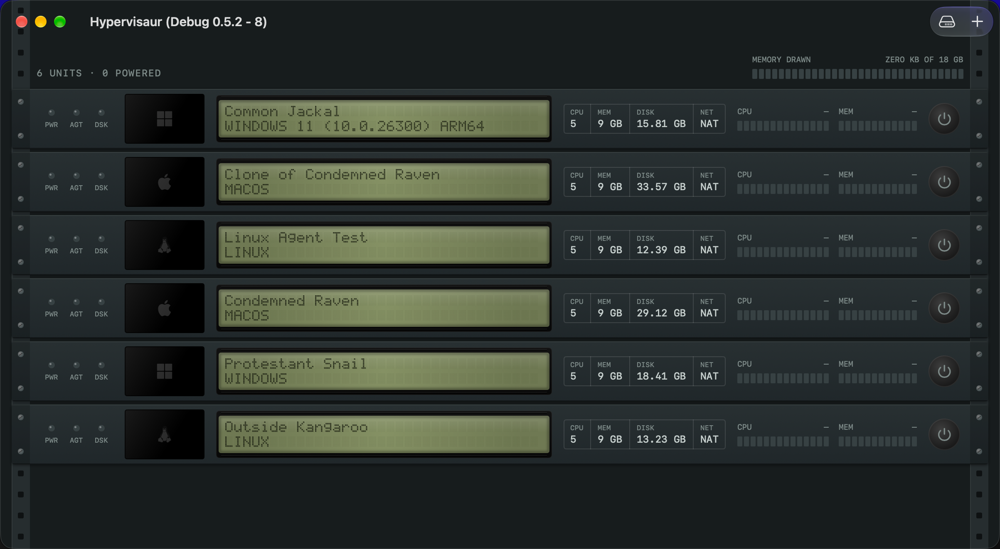
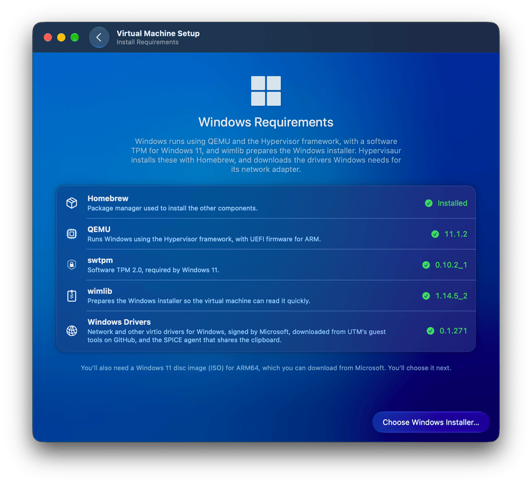
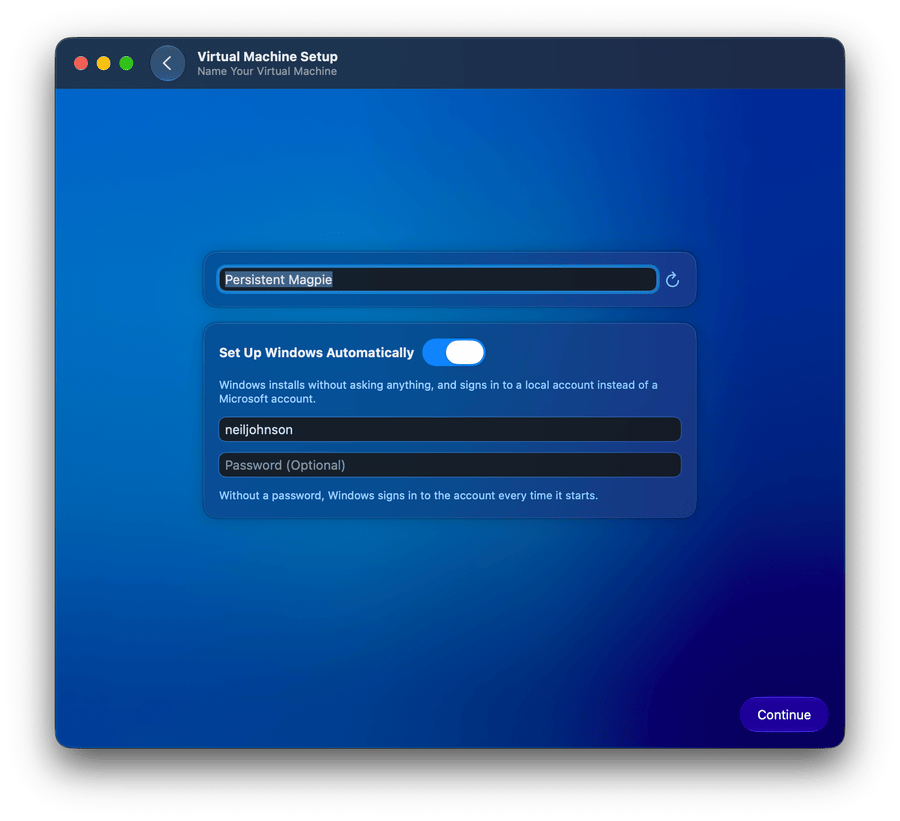
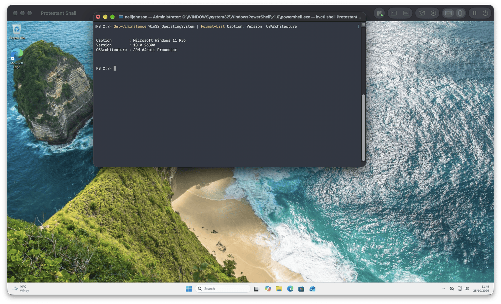
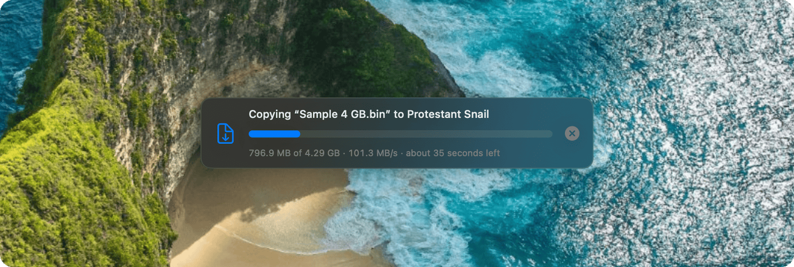
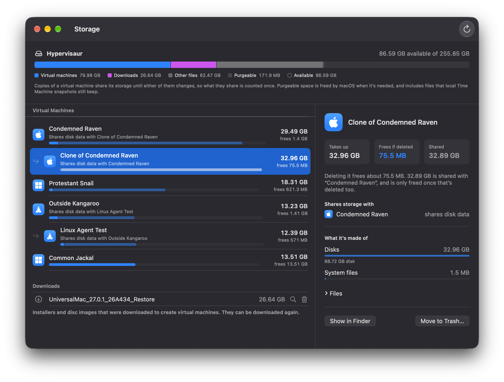
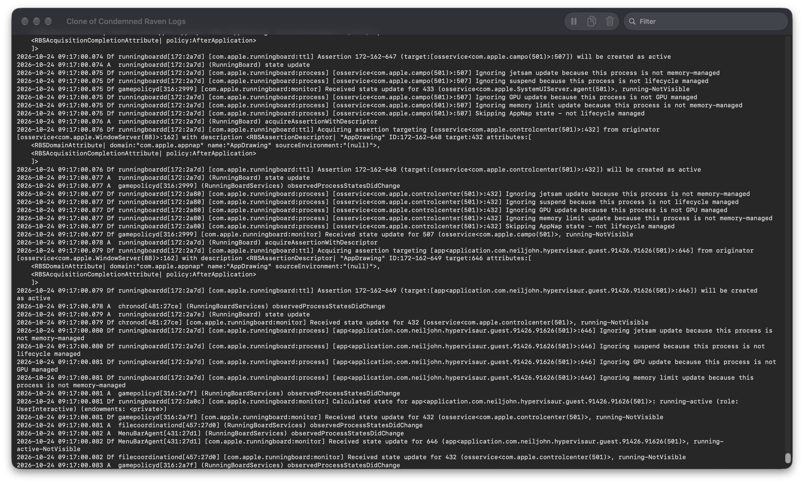
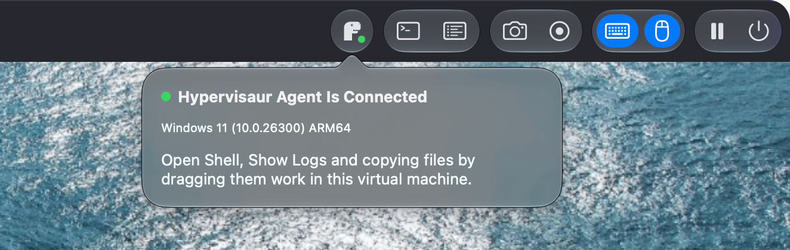
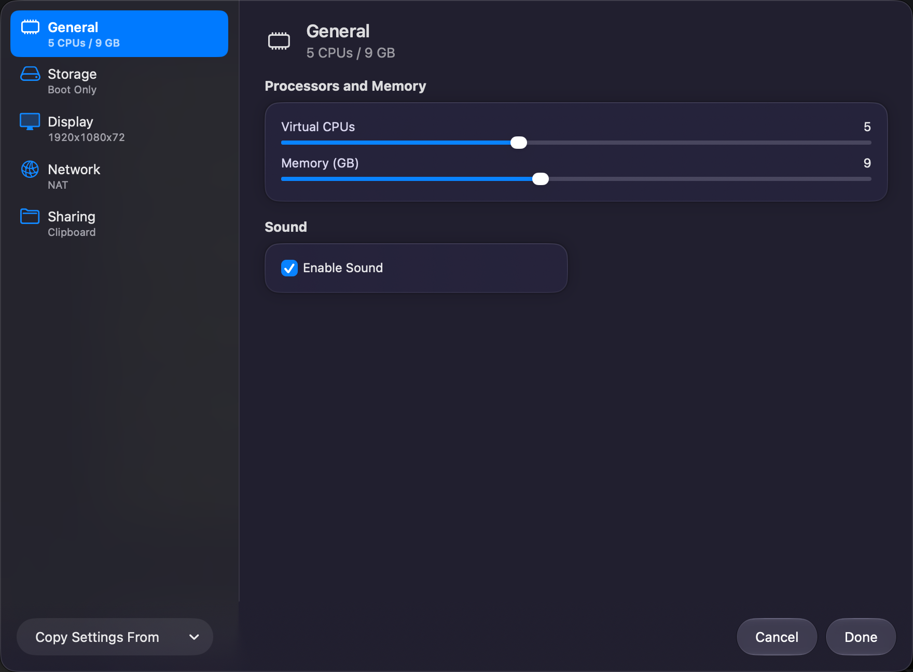
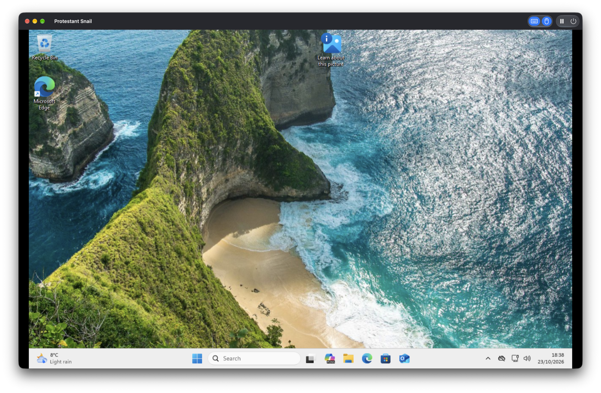

<p align="center">
  
</p>

<h1 align="center">Hypervisaur</h1>

<p align="center">Run macOS, Linux and Windows 11 virtual machines on Apple silicon Macs.</p>

https://github.com/user-attachments/assets/23ddd942-8b0a-49a5-a74b-4f0ab5acbc0f

<p align="center"><sub>Sharing folders with Windows 11, starting it from the rack, changing its resolution, dragging a 1 GB file into it, and seeing where the space goes in the Storage window. <a href="./assets/Video/Hypervisaur.mp4">Download the video</a></sub></p>

## Highlights

### Your virtual machines in a rack

The library shows each virtual machine as a unit in an equipment rack. Its lights show whether it's powered on, whether its agent is connected and when it's using its disk, a small screen shows what's on its display, and a backlit display shows its name, its system and what it's doing. Meters show how much of its processors and memory it's using, and the top of the rack shows how much of the Mac's memory they're using between them. Click a unit to start it, hold its power button to shut it down, or start it without a window from its menu.

<p align="center">
  
</p>

<p align="center"><sub>Starting three virtual machines from the rack. <a href="./assets/Video/Rack.mp4">Watch the video</a></sub></p>

### Windows 11 in a few clicks

Hypervisaur checks for everything Windows needs and installs what's missing with Homebrew in one click. Then choose Microsoft's Windows 11 disc image, and with **Set Up Windows Automatically**, Windows installs without asking anything and signs in to a local account by itself. See [Windows virtual machines](#windows-virtual-machines).

<p align="center">
  
  
</p>

### A shell in any virtual machine

The terminal button in a virtual machine's toolbar opens a shell in it in Terminal: PowerShell in Windows, a root shell in Linux and your own shell in macOS. It goes through the Hypervisaur agent rather than the network or SSH, so there's nothing to set up in the virtual machine's network, and `hvctl` does the same from your own scripts. See [Shells, commands and logs](#shells-commands-and-logs).

<p align="center">
  
</p>

### Drag and drop files

Drag files and folders onto a virtual machine's window to copy them to its desktop, and out of macOS and Windows virtual machines onto your Mac. Copies run at about 100 MB/s with Windows, well over 170 MB/s with macOS and over 300 MB/s with Linux, with their progress, speed and time left at the bottom of the window. See [Copying files](#copying-files).

<p align="center">
  
</p>

### See where your space goes

The Storage window shows what each virtual machine takes up, how much deleting it would actually free, and which ones were cloned from which. Clones share their storage until they change, so deleting the virtual machine a clone came from can free surprisingly little; the Storage window shows exactly how much, and what it's shared with. See [Storage](#storage).

<p align="center">
  
</p>

### Logs as they're logged

The logs button follows the virtual machine's logs: the event logs in Windows, the systemd journal in Linux and the unified log in macOS. You can filter, pause and copy them.

<p align="center">
  
</p>

### Know when the agent is ready

Shells, logs and copying files go through the Hypervisaur agent in the virtual machine. The dinosaur in the toolbar shows whether it's connected; click it to see which system it's running on, or what to do if it isn't connected yet.

<p align="center">
  
</p>

### Screenshots and screen recordings

The camera and record buttons save a screenshot of the virtual machine's display, or a movie of it with its sound, where macOS saves your screenshots. See [Screenshots and recordings](#screenshots-and-recordings).

### Let a coding agent do it

Hypervisaur includes an [MCP](https://modelcontextprotocol.io) server, so you can ask a coding agent such as Claude Code to "build a Windows VM with a local user called neil" and it creates the virtual machine, installs Windows and waits until it's at the desktop. It can then run commands in it, read its logs and look at its screen. See [Using Hypervisaur from a coding agent](#using-hypervisaur-from-a-coding-agent).

## About this project

Hypervisaur started as a fork of [VirtualBuddy](https://github.com/insidegui/VirtualBuddy) by Guilherme Rambo, and has since been heavily reworked. VirtualBuddy's way of running macOS and Linux with Apple's Virtualization framework is still at its heart, and Hypervisaur keeps VirtualBuddy's BSD license and copyright notice. It's an independent project, not affiliated with or endorsed by VirtualBuddy, so please report problems with Hypervisaur here rather than to VirtualBuddy.

Around that foundation, Hypervisaur has a library and settings of its own, Windows 11 virtual machines running with QEMU, with shared folders, clipboard sharing and saved sessions, an agent for running shells and commands in any virtual machine, following its logs and copying files in and out, a Storage window, and a server that lets coding agents create and run virtual machines. Much of that was written with [Claude Code](https://claude.com/claude-code), Anthropic's coding agent, and reviewed and tested on real virtual machines. VirtualBuddy doesn't accept contributions written with AI tools, which is why these changes live in a fork instead.

## Features

<p align="center">
  
</p>

- **macOS virtual machines** on macOS 12 or later, using Apple's Virtualization framework, with the macOS versions available to download kept up to date from this repository
- **Linux virtual machines** from Ubuntu, Fedora, Debian and Kali, always downloading the newest image of each release, or from any ARM64 disc image
- **Windows 11 virtual machines**, installed from Microsoft's Windows 11 ARM64 disc image, optionally without going through Windows Setup at all
- Clipboard sharing and shared folders for macOS, Linux and Windows guests, and saved sessions for macOS and Windows guests
- Screenshots and screen recordings of any virtual machine, with its sound
- Clones that run alongside the original and only take up the space of what's changed
- A Storage window that shows what each virtual machine takes up, what deleting it would free, and which ones were copied from which
- A shell in any running virtual machine, commands run from the Mac, and its logs as they're logged
- Drag and drop of files and folders between the Mac and macOS, Windows and Linux virtual machines, with progress and speed
- A library that shows each virtual machine as a unit in a rack, with lights for its power, agent and disk, a live picture of its screen, a backlit display with its name and system, meters for its processor and memory use, and the space it takes up on disk
- Settings for each virtual machine on one screen, with every section and a summary of it listed down the side
- Virtual machines that keep running in the background after you close their window, optionally keeping them and the Mac awake
- Windows that open at the size of the virtual machine's display, and keep its shape as you resize them
- A resolution menu in the window's toolbar for macOS, Linux and Windows virtual machines, and starting any virtual machine full screen in a space of its own
- Importing virtual machines from VirtualBuddy and UTM
- An [MCP](https://modelcontextprotocol.io) server, so a coding agent can build a Windows virtual machine for you

## Requirements

- A Mac with Apple silicon
- macOS 14 or later
- For Windows virtual machines, [Homebrew](https://brew.sh) and the [Windows 11 ARM64 disc image](https://www.microsoft.com/software-download/windows11arm64) from Microsoft

## Installing

Download the installer package from the latest release on the [Releases](../../releases) page and open it. It installs Hypervisaur in your Applications folder.

Hypervisaur checks GitHub once a day for a new release, and tells you when there is one. To update, download the new installer package and open it; your virtual machines stay as they are. You can also choose Hypervisaur › Check for Updates, or turn the daily check off in Settings.

## Windows virtual machines

<p align="center">
  
</p>

Choose Windows when creating a virtual machine. Hypervisaur first checks for what Windows needs on your Mac, and installs anything that's missing with a single click:

| Component | What it's for |
| --- | --- |
| [QEMU](https://www.qemu.org) | Runs Windows with the Hypervisor framework, using the UEFI firmware that comes with it |
| [swtpm](https://github.com/stefanberger/swtpm) | The TPM 2.0 that Windows 11 requires |
| [wimlib](https://wimlib.net) | Copies the Windows installer onto a disk that the virtual machine can start from quickly |
| [Samba](https://www.samba.org) | Shares folders on your Mac with Windows |
| Windows drivers | The virtio drivers for the network adapter, display and other devices, signed by Microsoft. They're downloaded from [UTM's guest tools](https://github.com/utmapp/qemu/releases) and checked against a known checksum. The SPICE agent that shares the clipboard comes with Hypervisaur and is installed with them |

QEMU, swtpm, wimlib and Samba come from Homebrew, which you need to install yourself. Then choose the Windows disc image and give the virtual machine a name. With **Set Up Windows Automatically**, Windows installs without asking anything and signs in to a local account with the name and optional password you choose. Without it, you go through Windows Setup as usual.

Installing takes about 10 minutes. Windows Setup uses a basic 800×600 display; afterwards, Windows uses the resolution in the virtual machine's display settings.

### Things to know

- You need your own Windows license. Windows is installed without a product key, so it isn't activated until you activate it.
- Windows virtual machines use NAT networking and sound output. USB devices aren't available for Windows yet.
- Each shared folder appears in Windows as a network drive named after it, starting at Z:, once you've signed in. The Hypervisaur agent connects the drives for whoever signs in, and they're served by Samba on your Mac, which only the virtual machine can reach. Read-only folders can't be changed from Windows. Folders you add or remove are shared or disconnected the next time the virtual machine starts. If Samba isn't installed yet, the virtual machine's Sharing settings offer to install it.
- Windows' own display settings don't offer any resolutions with its display driver, so change the resolution from the resolution menu in the window's toolbar, or from Guest › Resolution. See [Resolution and full screen](#resolution-and-full-screen).
- Save State works for Windows as it does for macOS, except while Windows Setup is running. Windows' sound device can't be saved, so it's disconnected while the state is saved and connected again when Windows resumes. A saved state may not resume after QEMU is updated with Homebrew; Hypervisaur then offers to discard it.
- Text you copy on your Mac can be pasted in Windows, and the other way round. You can turn this off with Share Clipboard in the virtual machine's settings.
- Windows virtual machines set up with Hypervisaur 0.1.0 need what's on the DRIVERS disk installing once, for the clipboard and the Hypervisaur agent: in Windows, open the DRIVERS drive, then right-click `VirtIODrivers\Setup.cmd` and choose Run as Administrator. After that, Windows keeps what's installed from the DRIVERS drive up to date by itself whenever it starts. Setup turns Fast Startup off, so that Windows always sees the newest drivers.
- The window keeps the shape of Windows' display, and follows it when you change Windows' resolution.
- The firmware that comes with QEMU doesn't support Secure Boot, so Windows Setup is told to skip that check.

## Using Hypervisaur from a coding agent

Hypervisaur includes `vbmcp`, a [Model Context Protocol](https://modelcontextprotocol.io) server. Add it to Claude Code with:

```bash
claude mcp add hypervisaur -- "/Applications/Hypervisaur.app/Contents/MacOS/vbmcp"
```

Then ask for something like "Build a Windows VM with a local user called neil, an 80 GB disk and 6 GB of memory". The agent creates the virtual machine, starts it in Hypervisaur and waits until Windows is signed in at the desktop. The first time, Hypervisaur asks whether to allow the server to control your virtual machines.

| Tool | What it does |
| --- | --- |
| `create_windows_vm` | Creates a Windows 11 virtual machine and installs Windows without interaction |
| `wait_for_windows_vm` | Waits until Windows is signed in at the desktop, reporting progress |
| `get_windows_vm_status` | Tells whether Windows is installing, starting up or signed in |
| `list_virtual_machines` | Lists the virtual machines in the library |
| `start_vm`, `stop_vm` | Starts a virtual machine, or asks it to shut down |
| `take_screenshot` | Returns a screenshot of a running virtual machine, so the agent can see what's on its display |
| `clone_vm` | Makes a clone of a virtual machine that can run alongside it |
| `run_command` | Runs a command in a running virtual machine and returns its output and exit status |
| `get_guest_logs` | Returns the most recent entries from a running virtual machine's logs |
| `get_windows_requirements`, `install_windows_requirements` | Checks for, and installs, what Windows virtual machines need |

## macOS virtual machines

When you start a macOS virtual machine with the guest app enabled, Hypervisaur attaches a disk with the Hypervisaur Guest app. Select the "Guest" disk in the Finder sidebar and open the app to install it. The guest app requires macOS 14 or later for clipboard sharing and automatic mounting of shared folders; on macOS 13, it only mounts shared folders.

To mount shared folders without the guest app, run this in the virtual machine's Terminal:

```bash
mkdir -p ~/Desktop/"Hypervisaur Shared" && mount -t virtiofs VirtualBuddyShared ~/Desktop/"Hypervisaur Shared"
```

Virtual machines are stored in `~/Library/Application Support/Hypervisaur`.

## Screenshots and recordings

While a virtual machine runs, the camera button in its window's toolbar saves a screenshot of its display, and the record button records its display and sound to a movie. They're saved where macOS saves screenshots, which is your desktop unless you've chosen somewhere else in the Screenshot app.

Hypervisaur needs permission to record the screen for recordings, and for screenshots of macOS and Linux virtual machines; macOS asks for it the first time. Screenshots of Windows virtual machines come straight from the virtual machine's display, at its full resolution.

## Shells, commands and logs

While a virtual machine runs, the terminal button in its window's toolbar opens a shell in it in Terminal, and the logs button opens a window that shows its logs as they're logged, which you can filter, pause and copy. Both are in the Guest menu too, as Open Shell (⌥⌘T) and Show Logs (⌥⌘L).

They work through the Hypervisaur agent in the virtual machine, which talks to Hypervisaur over a channel of its own rather than the network. The dinosaur in the window's toolbar shows whether the agent is connected; click it for what to do if it isn't.

- **Windows**: Windows installs the agent from the DRIVERS drive when it starts. Commands run in PowerShell, as the system account, and the logs are the System and Application event logs.
- **Linux**: install the agent once from the HYPERVISAUR disc, which Hypervisaur attaches until the agent has connected, by running `sudo mount -o ro /dev/disk/by-label/HYPERVISAUR /mnt && sudo sh /mnt/install.sh` in a terminal. It needs Python 3 and systemd. Commands run with `/bin/sh` as root, and the logs are the systemd journal.
- **macOS**: the agent is part of the Hypervisaur Guest app, so it runs while the guest app does. Commands run with your login shell, as you, and the logs are the unified log.

`hvctl` in `Hypervisaur.app/Contents/MacOS` does the same from your own terminal:

```sh
hvctl shell "Windows 11"                    # an interactive shell
hvctl exec "Windows 11" Get-Service vds     # runs a command and exits with its status
echo hello | hvctl exec "Ubuntu" 'tr a-z A-Z'
hvctl logs "Ubuntu"                         # follows the logs until you press Control-C
```

Only your user account can reach a virtual machine's agent from the Mac.

## Copying files

Drag files and folders from the Finder or your desktop onto a running virtual machine's window to copy them to the desktop in the virtual machine. Drag files and folders out of a macOS or Windows virtual machine's window onto the Finder or your desktop to copy them to your Mac. A panel at the bottom of the window shows how far each copy has got, how fast it's going and how long it has left, and stops it if you need to.

Copies go through the Hypervisaur agent, so they don't need the network or shared folders, and nothing appears in the virtual machine until it has all arrived.

- **macOS**: the Hypervisaur Guest app needs to be running. It updates itself from the Guest disk when it starts.
- **Windows**: Windows updates the agent from the DRIVERS drive when it starts, so restart a Windows virtual machine set up with an earlier version of Hypervisaur once.
- **Linux**: you can drop files on a Linux virtual machine, and they go to the desktop of the user signed in at its display. Dragging files out of Linux isn't available, since Linux desktops don't let the agent see what's being dragged. Hypervisaur updates an agent installed from an earlier version by itself.

## Resolution and full screen

Choose a resolution from the display menu in a running virtual machine's toolbar, or from Guest › Resolution.

- **macOS and Linux**: the display switches straight away, and the virtual machine starts at that resolution from then on. The menu isn't shown when the display is set to follow the size of the window, since resizing the window changes the resolution then.
- **Windows**: the menu lists the resolutions Windows' display driver offers, and Windows switches once somebody has signed in. Windows remembers the resolution, and starts at it next time.

To start a virtual machine full screen, in a space of its own, right-click it in the library and choose Start in Full Screen. It starts at the resolution it has. A saved virtual machine offers Resume in Full Screen, and a running one Show in Full Screen.

## Running in the background

Close a running virtual machine's window and choose **Keep Running** to leave it running without its window, or choose Guest › Run in Background (⇧⌘W). To start one without opening its window at all, choose **Start Without Window** from its menu in the library. The library shows "No Window" on its display; click it to open its window again, or use its menu in the library to save it, shut it down or keep it awake. In Settings, you can make keeping it running what closing a window always does.

With **Prevent sleep**, Hypervisaur keeps the Mac from going to sleep while a virtual machine runs in the background, and has the agent keep the virtual machine awake too: with `caffeinate` in macOS, `systemd-inhibit` in Linux and `SetThreadExecutionState` in Windows. The Mac's display can still turn off.

While the library is on screen, each running virtual machine shows a picture of its screen, updated every 30 seconds. Pictures of macOS and Linux virtual machines come from their window and need permission to record the screen, so they stay as they were while the window is closed, and there isn't one until the window has been opened. Pictures of Windows virtual machines are always up to date.

## Clones

Choose Clone from a virtual machine's menu in the library to make a copy that can run at the same time as the original. The clone gets its own network address and, for macOS, its own serial number. On APFS, the clone's files share their storage with the original's until either of them changes, so a clone takes seconds to make and only uses the space of what's different about it. The clone doesn't depend on the original afterwards: you can delete either one.

Duplicate makes an exact copy instead, with the same identity, which is what a saved session needs to resume. A virtual machine with a saved session can't be cloned; resume it and shut it down first.

To see how much space clones and the virtual machines they came from share, open Window › Storage. See [Storage](#storage).

Things the operating system in a clone keeps from the original:

- Windows keeps its computer name. This doesn't matter for networking, since each Windows virtual machine has a network of its own, but you can rename it in Settings › System › About.
- Most Linux distributions keep their machine ID, which some DHCP servers use to give out addresses, so a clone can get the same IP address as the original. Give the clone a new one with `sudo rm /etc/machine-id && sudo systemd-machine-id-setup`, then restart it.

## Storage

Window › Storage, or the drive button in the library's toolbar, shows how virtual machines use the space on the library's volume:

- A bar for the whole volume: virtual machines, downloads, virtual machines in the Trash, other files, space macOS can free when it needs to, and what's available.
- Each virtual machine, under the one it was cloned or duplicated from, with what it takes up and what deleting it would free. A clone shares its storage with the virtual machine it came from until either of them changes, so deleting one of them only frees what's changed in it. What they share is freed once both are deleted.
- For a selected virtual machine, which virtual machines it shares storage with, and what its disks, saved session, installation media and other files take up.
- Downloaded installers and disc images, which can be moved to the Trash and downloaded again, and virtual machines in the Trash, which take up space until you empty it.

Moving a virtual machine to the Trash from the library says how much space that frees, and what's shared with which virtual machines.

Hypervisaur finds out what's shared from APFS. It knows which virtual machines clones and duplicates made with Hypervisaur 0.5 or later came from. For older copies, it finds the virtual machines that share data from their disk images.

## Building

Hypervisaur builds with Xcode 26 or later.

1. In `VirtualBuddy/Config/Signing.xcconfig`, set `VB_BUNDLE_ID_PREFIX` to something of your own, such as `com.yourname.`
2. In `VirtualBuddy/Config/Security.xcconfig`, set `VB_DEVELOPMENT_TEAM` to your team ID
3. Choose your team under Signing & Capabilities for the VirtualBuddy and VirtualBuddyGuest targets
4. Build the `VirtualBuddy` scheme

The project's targets and modules keep VirtualBuddy's names so that changes from VirtualBuddy can still be merged.

To build a notarized installer package for release, run `Scripts/release.sh` with a Developer ID certificate, a Developer ID provisioning profile and an App Store Connect API key. The script describes what it needs.

## Acknowledgements

Hypervisaur stands on the work of [VirtualBuddy](https://github.com/insidegui/VirtualBuddy) and its contributors, and on [QEMU](https://www.qemu.org), [swtpm](https://github.com/stefanberger/swtpm), [wimlib](https://wimlib.net), [Samba](https://www.samba.org), [UTM](https://github.com/utmapp/UTM), the [virtio-win drivers](https://github.com/virtio-win/kvm-guest-drivers-windows), [Homebrew](https://brew.sh) and the [USB ID Repository](http://www.linux-usb.org/usb-ids.html). See [THIRD_PARTY_NOTICES.md](./THIRD_PARTY_NOTICES.md) for the licenses of the software that Hypervisaur includes or uses.

## License

Hypervisaur is available under the [BSD 2-Clause License](./LICENSE).
